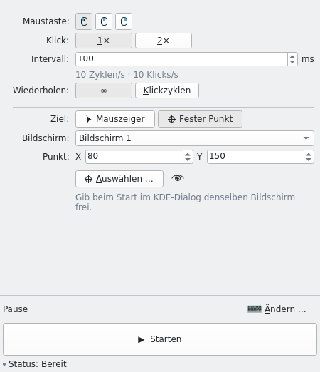

# Klickmeister

Automatische Mausklicks für KDE Plasma.

Klickmeister übernimmt wiederholte Mausklicks unter KDE Plasma 6 auf Wayland. Wähle Position, Klickintervall und Wiederholungen. Ein globales Tastenkürzel startet und stoppt das Klicken.



## Funktionen

- Linke, rechte oder mittlere Maustaste
- Einzel- oder Doppelklick
- Aktuelle Mauszeigerposition oder feste Position auf einem ausgewählten Bildschirm
- Positionsauswahl direkt auf dem Desktop, mit Feineinstellung per Pfeiltasten
- Eine festgelegte Anzahl von Klickzyklen oder Klicken bis zum Stopp
- Klickintervalle von 10 Millisekunden bis 24 Stunden

Ein Klickzyklus entspricht einem Einzel- oder Doppelklick. Drei Zyklen erzeugen drei Einzelklicks oder drei Doppelklicks, also sechs einzelne Klicks. Bei 10 ms plant Klickmeister höchstens 100 Zyklen pro Sekunde. Die Oberfläche zeigt die Zyklus- und Klickrate an; bei Intervallen über einer Sekunde zeigt sie den Abstand zwischen den Zyklen.

## Installation

Klickmeister benötigt KDE Plasma 6, eine Wayland-Sitzung und den KDE-Portaldienst. Das mitgelieferte Paket ist für Arch Linux und darauf basierende Distributionen wie CachyOS vorgesehen.

### Fertiges Paket herunterladen

1. Öffne die [Downloads der neuesten Version](https://github.com/Jerry0205/Auto-Clicker/releases/latest).
2. Lade die Datei **`klickmeister-…-x86_64.pkg.tar.zst`** herunter.
3. Öffne ein Terminal im Downloadordner und installiere die Datei:

```bash
sudo pacman -U ./klickmeister-*-x86_64.pkg.tar.zst
```

Pacman installiert auch die benötigten Laufzeitabhängigkeiten. Danach ist **Klickmeister** im KDE-Anwendungsmenü verfügbar. Git, Rust und das Klonen des Projekts sind dafür nicht nötig. Verwende ein vollständig aktualisiertes Arch-/CachyOS-System mit x86_64-Prozessor.

Die Archive mit **`-aur.tar.gz`** im Namen sind für Paketbetreuer bestimmt. Zum direkten Installieren verwendest du die **`.pkg.tar.zst`**-Datei.

### Über das AUR

Die Releases enthalten fertige Paketbeschreibungen für **`klickmeister-bin`** (ohne Kompilieren) und **`klickmeister`** (aus Quellcode). Sobald ein Betreuer sie im AUR veröffentlicht hat, ist die Installation beispielsweise mit einem vorhandenen AUR-Helfer möglich:

```bash
yay -S klickmeister-bin
```

Das Erzeugen eines Releases veröffentlicht die Paketbeschreibungen noch nicht im AUR. Die Schritte dafür stehen unter [Releases und AUR](docs/RELEASING.md).

## Erste Schritte

1. Öffne Klickmeister und bestätige im KDE-Dialog das Tastenkürzel für Start und Stopp.
2. Wähle Maustaste, Klickart und Klickintervall.
3. Lege die Wiederholungen und die Klickposition fest.
4. Drücke das Tastenkürzel oder wähle **Starten**. Bestätige die Freigabe für die Maussteuerung im KDE-Dialog.
5. Drücke das Tastenkürzel erneut oder wähle **Stoppen**, um das Klicken zu beenden.

Als Tastenkürzel wird `Pause` vorgeschlagen. Das aktive Kürzel steht in der Fußleiste; mit **Ändern …** lässt es sich im KDE-Dialog anpassen. Klickmeister startet erst, wenn ein Tastenkürzel für Start und Stopp eingerichtet ist.

### Start an der Mauszeigerposition

Bei **Mauszeiger** folgt jeder Klick dem Mauszeiger. Beim Start über die Schaltfläche beginnt nach der Freigabe ein Countdown von drei Sekunden. Bewege den Mauszeiger in dieser Zeit zum Ziel. **Start abbrechen** oder das Tastenkürzel beendet den Countdown ohne Klick.

Beim Start per Tastenkürzel beginnt das Klicken nach der Freigabe sofort. Das gilt auch beim Start an einer festen Position.

### Feste Position wählen

1. Wähle **Fester Punkt** und den gewünschten **Bildschirm**.
2. Wähle **Auswählen …**. Die Positionsauswahl öffnet sich auf diesem Bildschirm.
3. Setze die Position mit einem Linksklick. Mit den Pfeiltasten verschiebst du sie um einen Schritt, mit `Umschalt` + Pfeiltasten um zehn Schritte.
4. Bestätige mit `Enter`. `Esc` oder ein Rechtsklick bricht die Auswahl ab.

Nach einem Linksklick oder einer Korrektur per Pfeiltasten bleibt die Position fixiert; Mausbewegungen verändern sie dann nicht mehr. Das Augensymbol **Punkt anzeigen** markiert das gespeicherte Ziel kurz, ohne zu klicken.

Das Hauptfenster wird während der Auswahl minimiert und danach mit seiner bisherigen Größe, Position und Maximierung wiederhergestellt. Die Auswahl liegt direkt über dem Desktop. Sie erstellt keine Bildschirmaufnahme und verwendet keine Lupe.

Das Hauptfenster kann auf einem anderen Monitor bleiben als die feste Position. Klickmeister ordnet die von KDE gelieferten Monitorinformationen vor dem ersten Klick anhand von Position und logischer Größe eindeutig zu. Fehlende, nicht passende oder mehrdeutige Angaben brechen den Start ab; gespiegelte Ausgänge mit identischer Geometrie werden nicht unterstützt.

Eine feste Position bleibt mit ihrem Bildschirm gespeichert. Ändern sich Auflösung oder Skalierung, muss sie erneut bestätigt werden. Ist der Bildschirm nicht verfügbar oder nicht eindeutig wiederzuerkennen, prüfe Bildschirm und Koordinaten und wähle **Position bestätigen** oder eine neue Position. Die gespeicherte Position bleibt erhalten, bis du sie bestätigst oder ersetzt.

## Freigaben und Datenschutz

KDE fragt nach Freigaben für das globale Tastenkürzel und die Maussteuerung. Bei einer festen Position kommt eine Bildschirmfreigabe für die Monitor-Streams aller Ausgänge hinzu, damit Klickmeister die Koordinaten eindeutig zuordnen kann. Verwendet werden nur die Monitorinformationen; Bild- oder Videodaten werden nicht gelesen.

Klickmeister liest keine Tastatureingaben, Passwörter oder Zwischenablagen und fordert keine Screenshots an. Gespeichert werden nur die Einstellungen. Die Anwendung erfasst keine Nutzungsdaten oder Telemetrie und benötigt keinen Netzwerkzugriff.

Mit dem Schließen des Fensters endet die Anwendung einschließlich ihrer Freigaben. Es gibt keinen Hintergrunddienst und keinen Autostart.

## Häufige Fragen

### Warum ist „Starten“ nicht verfügbar?

Für jeden Lauf muss das Tastenkürzel für Start und Stopp eingerichtet sein. Falls die Freigabe abgelehnt, die Taste entfernt oder die Freigabe beendet wurde, wähle in der Fußleiste die Schaltfläche **Erneut versuchen**. Ein Neustart ist dafür nicht nötig.

### Warum wird eine feste Position nicht übernommen?

Eine feste Position gilt nur für ihren ausgewählten Bildschirm, unabhängig vom Standort des Hauptfensters. Nach Änderungen an Anordnung, Auflösung oder Skalierung sowie bei einer fehlenden Bildschirmzuordnung muss die Position in Klickmeister geprüft und bestätigt werden.

### Wann werden die Einstellungen gespeichert?

Die Einstellungen werden beim Start eines Klicklaufs und beim Schließen gespeichert. Änderungen werden auch übernommen, wenn kein Lauf gestartet wurde. Schlägt das Speichern beim Schließen fehl, kannst du zur Anwendung zurückkehren oder **Ohne Speichern schließen** wählen. Beim Zurückkehren werden die Freigaben erneut angefragt: das Tastenkürzel sofort, die Maussteuerung beim nächsten Start.

### Funktioniert Klickmeister unter X11?

Klickmeister ist für KDE Plasma unter Wayland ausgelegt. X11 wird nicht unterstützt.

## Entwicklung

Installiere auf Arch Linux die Build- und Laufzeitabhängigkeiten:

```bash
sudo pacman -S --needed base-devel git rust cargo clang lld pkgconf qt6-base qt6-declarative qt6-wayland qt6-tools kirigami qqc2-desktop-style xdg-desktop-portal xdg-desktop-portal-kde python
```

Cargo-Befehle bauen den aktuellen Checkout einschließlich lokaler Änderungen. Der `PKGBUILD` im Projektstamm verwendet einen festgelegten, mit Prüfsumme gesicherten Quellstand für Version 0.1.3. Mit `makepkg --allsource --nodeps` lässt sich ein Quellpaket einschließlich des Projektarchivs erstellen und in einem anderen Verzeichnis bauen. Cargo-Abhängigkeiten werden beim Paketbau mit `cargo fetch --locked` geladen.

`bash scripts/build-release.sh` baut den aktuellen Checkout als installierbares Paket und erzeugt die AUR-Paketbeschreibungen samt Prüfsummen in `dist/`. Der GitHub-Workflow **Release packages** führt das bei einem Versionstag automatisch aus, prüft die Installation und stellt die Dateien unter [Releases](https://github.com/Jerry0205/Auto-Clicker/releases) bereit. Details stehen unter [Releases und AUR](docs/RELEASING.md).

### Bauen und prüfen

```bash
cargo fmt --all -- --check
cargo clippy --locked --all-targets -- -D warnings
cargo test --locked --all-targets
dbus-run-session -- cargo test --locked --all-targets -- --ignored
cargo build --locked --release
bash tests/qml-smoke.sh target/release/klickmeister
QT_QPA_PLATFORM=offscreen QT_QUICK_BACKEND=software QT_QUICK_CONTROLS_STYLE=org.kde.desktop /usr/lib/qt6/bin/qmltestrunner -import tests/qml/mocks -input tests/qml
python tests/check_coordinate_accessibility.py # grafische Sitzung mit AT-SPI und PyGObject
bash tests/qml-wayland.sh # isolierter KWin mit drei Bildschirmen, benötigt kscreen-doctor
KLICKMEISTER_TEST_SCALE=1.5 bash tests/qml-wayland.sh
```

Die QML-Tests verwenden den KDE-Control-Stil und einen Controller-Testersatz. Die AT-SPI-Prüfung startet das Hauptfenster ohne Worker und prüft die zugänglichen Namen der Koordinatenfelder und ihrer Texteingaben. Die D-Bus-Tests prüfen den Rust-Worker gegen simulierte Portale. Dazu gehören Klickfolgen, Stopps, verzögerte Tastenkürzel-Signale, Sitzungsende und Fehler beim Loslassen einer Maustaste. Diese Tests erzeugen keine Mausklicks auf dem Desktop.

Tastenkürzel-Signale, die sich während eines Laufs angestaut haben, dürfen diesen noch stoppen, danach aber keinen neuen Lauf starten. Eine neue Betätigung nach dem Stopp startet wie gewohnt.

Echte KDE-Dialoge und die Zeigersteuerung auf physischen Bildschirmen werden zusätzlich in einer nativen Plasma-Wayland-Sitzung geprüft. Die Werkzeuge und Voraussetzungen dafür sind unter [tests/native](tests/native/README.md) dokumentiert.

Prüfe den Start-Countdown manuell an einem eigenen Testziel: Vor Ablauf der drei Sekunden darf kein Klick erfolgen. **Start abbrechen** und das Tastenkürzel müssen den Countdown ohne Klick beenden. Wiederhole die Prüfung mit bereits erteilter Freigabe. Starts per Tastenkürzel und mit fester Position müssen ohne Countdown beginnen.

GitHub Actions führt Formatierung, Clippy, Rust- und Portaltests, QML-Tests im KDE-Stil, Python-Tests sowie Desktop- und AppStream-Validierung aus. Danach folgen Release-Build und QML-Smoke-Test. Ein separater Job prüft die QML-Oberfläche unter einem virtuellen KWin mit drei Bildschirmen. Beide Jobs verwenden Arch-Linux-Container und die Cargo-Lockdatei; native Tests mit echten KDE-Dialogen bleiben eine manuelle Prüfung.

Der virtuelle KWin-Job verwendet einen zusammenhängenden Arch-Archivstand mit KWin 6.7.5, da KWin 6.8 das gerätefreie QPainter-Backend entfernt hat. Ursache, isolierte Reproduktion und Aktualisierung des Archivstands sind unter [tests/virtual-wayland.md](tests/virtual-wayland.md) beschrieben.

### QML-Sprachserver

Führe zuerst `cargo build --locked` und danach `bash scripts/setup-qmlls.sh` aus. Das Skript ermittelt das aktive Cargo-Buildverzeichnis, auch bei `CARGO_TARGET_DIR` oder `build.target-dir`, und schreibt die von Git ignorierte `.qmlls.ini`. Nach einem Wechsel des Buildverzeichnisses muss das Skript erneut ausgeführt werden. Python 3 ist erforderlich.

`python tests/check_qmlls_checkout.py` prüft den committeten Stand in einem frischen Checkout mit anderem Pfad und fragt die `AppController`-Eigenschaften direkt beim QML-Sprachserver ab.

### Desktop-Integration

Der Qt-Desktop-Dateiname lautet `io.github.jerry0205.klickmeister` und entspricht der installierten `.desktop`-Datei. Der QML-Smoke-Test prüft diesen Wert. Klickmeister meldet auch seine separaten D-Bus-Verbindungen vor dem ersten Portalaufruf mit dieser ID bei der [Portal-Registry](https://flatpak.github.io/xdg-desktop-portal/docs/doc-org.freedesktop.host.portal.Registry.html) an. Damit funktioniert die Zuordnung auch beim direkten Start der Binärdatei. Die `.desktop`-Datei muss im Anwendungsverzeichnis installiert sein; für Entwicklungsprüfungen genügt `~/.local/share/applications/`. Bei älteren Portaldiensten ohne Registry erfolgt die Zuordnung weiterhin über den Startkontext.

Details zum Aufbau und zu Sicherheitsentscheidungen stehen in [ARCHITECTURE.md](ARCHITECTURE.md) und [SECURITY_REVIEW.md](SECURITY_REVIEW.md).

## Lizenz

Klickmeister ist freie Software unter der [MIT-Lizenz](LICENSE).
